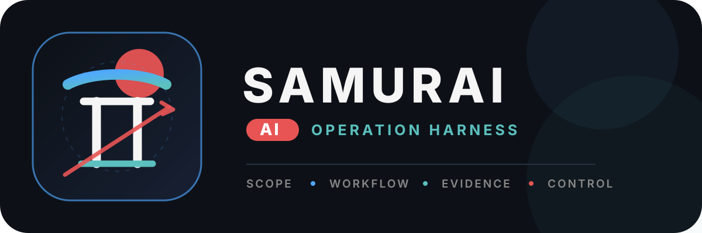

<p align="center">
  
</p>

<p align="center">
  <a href="README.md">Русский</a> · <strong>English</strong>
</p>

# Samurai AI

Samurai AI is a local-first TUI harness for authorized Red Team operations, Bug Bounty research, CTF/HTB, and Operation Planning. The product is built around a governed operation rather than an unrestricted chat connected to tools.

## Principles

- **Scope before action** — boundaries and rules come before execution.
- **Workflow before autonomy** — autonomy exists only inside an understandable process.
- **Evidence before finding** — a scanner result is not yet a vulnerability.
- **Operator stays in control** — the operator can review, stop, and recover work.
- **Policy outside the model** — scope, approvals, and transitions are never delegated to an LLM.

## Current status

**Stage 0**, **Stage 1/1b**, **Stage 2a/2b**, **Stage 3**, **Stage 4 in full — the Bug Bounty, CTF/HTB, Red Team, and Operation Planning playbooks**, **Stage 5 in full — parallel specialized agents, campaign memory, custom playbooks/skills, CALDERA/VECTR exports, headless/CI, and HTML reports**, and **Stage 6a — the evaluation harness with metrics and regression gates**, **Stage 6b — fault injection, prompt-injection containment, soak, and migration/backup/restore suites**, and **Stage 6c — the standalone binary, reproducible builds, signed releases, and the compatibility policy (`md/compatibility.md`)**, and **Stage 7 (wave 1) — the governed `recon.httpx-probe` and `scan.nuclei` security tool adapters per the threat review**, and **Stage 8 — TUI UX: arrow-key navigation (language chooser, `/model` picker with reasoning effort), black theme by default, and a colorized journal**, and **Stage 8+ — Journal/Plan/Findings/Access tabs, slash-command autocomplete, text selection and copy, `/yolo` mode, directory trust (`/trust`), and cwd display in the status bar** and **Stage 9 — harness UX: permission modes, plan mode, goal mode, steering, shell mode, `/undo` and `/compact`** are complete.

Implemented:

- four operation modes and a validated lifecycle;
- include/exclude scope for domains, wildcards, URL origins, and IP/CIDR;
- plans, tasks, dependencies, stage gates, and artifact requirements;
- R0–R4 approvals and approval-gated tool execution;
- immutable evidence artifacts with SHA-256 and redaction;
- a findings workflow from candidate to reported;
- snapshots/restore/fork, recovery reconcile, and plan/scope diff;
- a versioned tool registry, shell-free `process.exec`, and `http.fetch` through the scope broker;
- Docker sandbox profiles with a signed allowlist, scoped egress proxy with DNS pinning;
- an MCP stdio/HTTP client and a persistent secrets vault (AES-256-GCM);
- prompt-injection warnings and an `untrusted-external` trust label;
- LLM provider abstraction (openai-compatible, anthropic, gemini, ollama),
  a ModelRouter with retry/fallback, per-operation budgets, and a
  Planner/Executor/Parser/Verifier orchestrator with a closed command schema;
- the Bug Bounty playbook: program rules, a scope-enforced asset ledger with
  diff, fingerprint-based finding dedup, and governed gates;
- reports (Markdown/JSON) built only from validated findings, an evidence
  package with a SHA-256 manifest, secret redaction, and out-of-scope blocking;
- the CTF/HTB playbook: BRD challenge categories, a hypothesis log with a
  state machine, an immutable flag ledger with regex format validation and
  proof artifacts, a journal-derived replay, and redacted Markdown/JSON
  writeups with export;
- the Red Team playbook: an ROE with a blocking approval before execution,
  an ATT&CK-mapped attack path with dependencies, detection expectations and
  outcomes, stop checkpoints, and a debrief with open gaps, redaction, and
  SHA-256 export;
- the Operation Planning playbook: scenarios without active actions, test
  cases with ATT&CK/kill chain mapping and detection expectations, stop
  points, and a runbook (Markdown/JSON) generated in planning status with
  redaction and export;
- parallel specialized agents (swarm): a bounded thread pool over
  independent plan tasks, general/recon/testing/analysis specializations
  (prompt-level only; governance is identical), ready-task auto-selection,
  model approval preflight, a wall-time vs sequential-estimate report with
  speedup, SQLite v13, the `swarm ready/run/list/show` CLI and TUI `/swarm`;
- campaign memory: workspace-scoped entries (methodology/decision/failure/note)
  with retention and deletion, read-only for agents (a bounded redacted
  digest in prompts, audited in agent.run.start), the `memory` CLI and
  TUI `/memory`;
- custom playbooks (JSON templates with structural validation, immutable
  storage, `playbook install/use/list-custom`) and trusted versioned skills
  (`--trusted` required, sha256 recorded, bounded injection into executor
  prompts), TUI `/playbooks` and `/skills`, SQLite v17;
- a stable exit code contract (0/1/2, pinned by tests), NDJSON journal
  export (`events export`), a headless mode for CI (`headless run` with a
  JSON summary), and GitHub Actions CI (ruff, strict mypy, pytest, build);
- CALDERA export (an adversary pack from executed attack steps with ATT&CK
  tactics) and VECTR export (`vectr-campaign@v1` JSON) with redaction and
  a sha256 manifest;
- an HTML bug bounty report and a self-contained read-only HTML operation
  dossier (`operation export --format html`) with escaping and redaction;
- an evaluation harness (Stage 6a): declarative JSON scenario suites on a
  deterministic scripted provider, solve/validation rate, cost, wall time,
  interventions, invalid actions and false positive metrics computed from the
  event journal, and baseline comparison for regression gating (`eval run`,
  `eval compare`), with the `evals/smoke.json` smoke suite in CI;
- plan and findings boards (`/tasks`, `/findings`) with row actions and details;
- child sessions via `/subagent` and `Ctrl-G`: a child takes a plan task, works in the background, stays visible and stoppable;
- a `Ctrl-P` palette over every action, a `?` key overlay, a run inspector (`/inspect`, `Ctrl-I`) with eight groups and a freshly re-checked scope decision, a first-run welcome pane and empty states;
- RU/EN first-run language selection and `/lang` switching;
- SQLite migrations v1–v17, append-only events, and optimistic concurrency;
- CLI and TUI with real kernel/recovery/tool/agent/playbook views;
- 722 unit/integration/CLI/TUI tests.

Not implemented yet: PDF reports (no stdlib path), live CALDERA/VECTR API
integrations (export-only), wave-2 security tools (subfinder/nmap/ffuf —
technical blockers documented in `md/threat-review-security-tools.md`),
LLM streaming, per-argument permission rules with a doom-loop guard,
OS-level background shell jobs, extension seams/plugins, an operation web surface, full egress enforcement on
Docker Desktop for Mac, and OS package installers (a bare standalone binary is
available).

## Installation

```bash
curl -fsSL https://raw.githubusercontent.com/0nlyr00t/Samurai-AI/main/install.sh | bash
```

The script installs uv (if missing) and installs `samurai` via
`uv tool install` from this repository — the Python 3.12+ toolchain is
provided automatically. A specific release: `... | bash -s -- --ref v0.2.0`.

Update to the latest release:

```bash
samurai update          # check and update
samurai update --check  # only check for a newer version
```

## Development quick start

Requirements: Python 3.12+ and uv.

```bash
git clone https://github.com/0nlyr00t/Samurai-AI.git
cd Samurai-AI
uv sync --locked
uv run pytest
```

Create an operation and open the TUI:

```bash
uv run samurai operation create "Lab" \
  --mode ctf-htb \
  --objective "Solve the authorized lab" \
  --include 192.0.2.10

uv run samurai tui
```

Quality checks:

```bash
uv run ruff check .
uv run mypy src
uv build
```

## Target distribution

The product ships as a standalone per-platform `samurai` executable (PyInstaller one-file, no Python or uv required on the target machine): build locally with `bash packaging/build_binary.sh`; release builds for linux-x86_64/darwin-arm64/windows-x86_64 are produced by `.github/workflows/release.yml` on `v*` tags and signed with Sigstore keyless (verification — `md/compatibility.md`). The sdist/wheel are bit-reproducible (`packaging/check_reproducible.sh` in CI). Docker, security tools, MCP servers, and Ollama remain optional dependencies detected through health checks.

## Models

The LLM orchestration phase will introduce an extensible model provider registry with capability negotiation: OpenAI, Anthropic, Google Gemini, Azure OpenAI, AWS Bedrock, DeepSeek, xAI, Qwen, Moonshot/Kimi, Mistral, OpenRouter, OpenAI-compatible endpoints, and first-class Ollama.

Playbooks must not depend on vendor-specific APIs.

## Localization

The product must offer an **RU/EN** language choice on first launch, persist the selection, and allow switching later. Every new operator-facing string is added to Russian and English resources together.

## Documentation

- `md/requirements.md` — business requirements.
- `md/development-plan.md` — roadmap, phases, and acceptance criteria.
- `md/compatibility.md` — compatibility policy and release signature verification.
- `md/threat-review-security-tools.md` — threat review of the extended security tool set (RU).
- `Agent.md` — development handoff.
- `README.md` — Russian README.

## Authorized use only

Samurai AI is intended only for authorized security research, CTF/HTB, Bug Bounty work within program rules, and Red Team/adversary emulation with explicit permission from system owners. Do not use the product outside an agreed scope.
