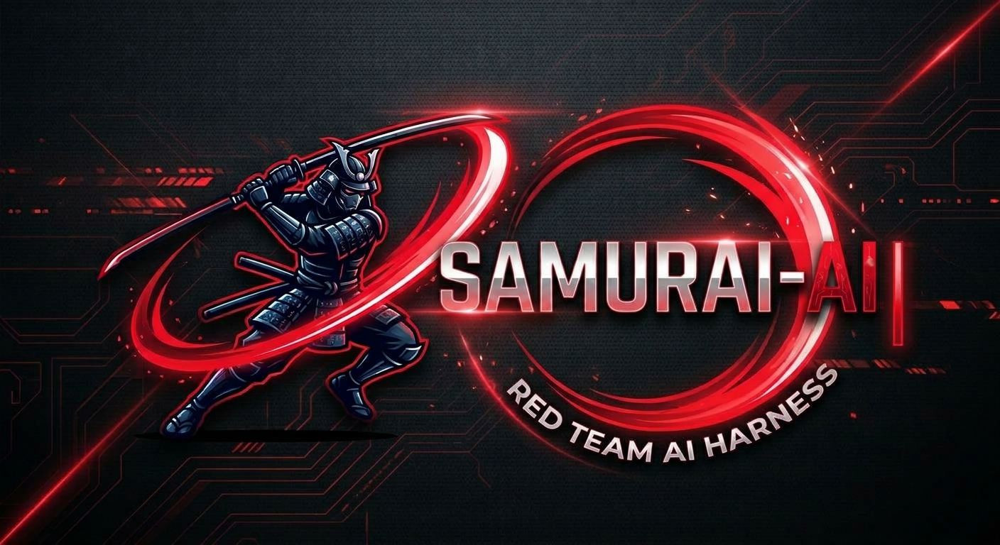
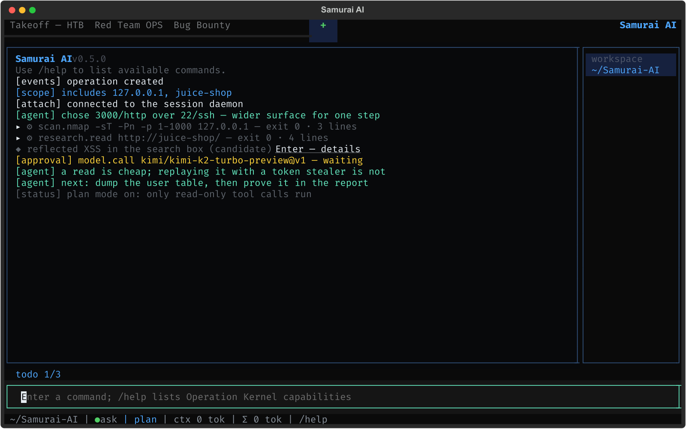

<p align="center">
  
</p>

<p align="center">
  <a href="README.md">Русский</a> · <strong>English</strong>
</p>

# Samurai AI

A local harness for authorized attacking: red teaming, bug bounty, CTF/HTB, operation planning. An operation is run as a process — boundaries, plan, evidence, report — and the agent works inside that process instead of in an unbounded chat with tools.

TUI and CLI, state on the operator's machine, secrets in a local vault. Tools run in containers pinned by digest; out-of-scope calls and dangerous actions go through policy rather than through trust in the model.

<p align="center">
  
</p>

## Install

macOS and Linux, without root and without Python:

```bash
curl -fsSL https://raw.githubusercontent.com/0nlyr00t/Samurai-AI/main/install.sh | bash
```

The installer takes the latest release binary, checks its sha256 and, when `cosign` is installed, verifies the Sigstore signature bound to the release workflow identity; a mismatch aborts before anything is installed. It installs into `~/.local/bin` and adds that directory to PATH.

- a specific release: `... | bash -s -- --ref v0.4.0`
- `--dry-run` — print the plan, change nothing
- `--force-uv` — install from the tag via uv instead of the binary

Releases are built for linux-x86_64, linux-arm64, darwin-arm64 and windows-x86_64. On platforms without an artifact (Intel Macs) the installer builds from the tag via uv. The sandbox needs Docker.

Update: `samurai update` (`--check` only reports). Verifying signatures: [`md/compatibility.md`](md/compatibility.md).

## Uninstall

```bash
curl -fsSL https://raw.githubusercontent.com/0nlyr00t/Samurai-AI/main/uninstall.sh | bash
```

Removes the binary, the PATH block, the state directory (`~/.config/samurai`) and the belt images. `--keep-state` keeps the state, `--yes` skips the question, `--dry-run` shows the plan; without a terminal it removes nothing silently.

## Capabilities

**Operation.** Scope only widens with a confirmation: `scope add` asks when a rule really widens the boundary and stays silent when the target is already covered. Four modes (bug bounty, CTF/HTB, red team, operation planning), an audited lifecycle, include/exclude scope for domains, wildcards, URL origins and IP/CIDR, immutable evidence with SHA-256, findings from candidate to reported, snapshots, restore, fork, recovery reconciliation.

**Plan and approvals.** Tasks with dependencies, stages and gates, required artifacts, risks R0–R4. Execution above R0 waits for the operator; `ask`, `yolo`, `never` modes and per-argument `allow|ask|deny` rules keep policy outside the model.

**Tools.** `recon.subfinder-passive`, `recon.dnsx-resolve`, `recon.httpx-probe`, `scan.nmap`, `scan.nuclei`, `scan.wpscan`, `fuzz.ffuf`, `research.search`, `research.read`, `intel.shodan`, `intel.censys`, `loot.scan` (credentials from a body), remote administration (ssh, SMB, an RDP probe, ADB), VMs and disks, exploit building and running. A new tool is a JSON manifest; packages of tools, profiles and playbooks install as plugins with a sha256 per file.

**Sandbox.** Docker profiles pinned by digest, `--cap-drop ALL`, read-only root, CPU/memory/PID limits, a scoped egress proxy with DNS pinning and connection audit. The belt is split by blast radius: the admin image carries no compiler, the exploit image carries no foreign credentials.

**Impact.** A ladder `read → write → auth-bypass → data-export → rce` with scores, a reporting threshold and an escalation budget; reports refuse findings below the threshold. Traffic, output and files are kept as artifacts.

**Search progress.** The Progress tab shows how many brute-force, fuzzing and password-spray tasks are done out of the total (bar, percent, counter, refreshed every three minutes) and keeps the top findings in sight — by severity, live.

**Stopping and the journal.** `Ctrl+C` stops the run, not the app: the step in flight reaches its results, the hypotheses get checked, the conclusion is printed, and only then does the work stand down. A second press leaves. Grey process lines fold into one line and open with `Ctrl+E`, Enter or a click; on a failure they open themselves. Text is selectable with the mouse at any moment: `Ctrl+C` copies a selection, a double click takes a word, `Ctrl+Shift+C` copies always.

**Session.** A daemon on a local unix socket: work survives a closed terminal, a second client or the TUI screen (`Ctrl-D`) attaches to the stream, answers the agent and approves steps. Socket 0600, read-only clients, the shared access table decides.

**Remote daemon.** `attach --ssh host` works against a daemon on another machine through its forwarded socket; permissions stay on the far side.

**Network behind a relay.** When a target is only reachable from a VM or a jump host, `--relay "prlctl exec '<uuid>'"` sends the network tools there; no container, while scope and artifacts stay and the relay's own address joins the scope. `samurai doctor --relay "<prefix>"` says up front which tools the far side lacks.

**Local tools.** On the operator's own machine `samurai` runs installed tools natively, without a shell: the executable and argv come from a reviewed catalogue recipe, while scope and approvals stay mandatory. `samurai tool capabilities` reports the environment and the binaries it finds without changing anything; a missing tool is installed from its recipe — `tool provision <id> --dry-run` prints the platform, package, commands, privilege and healthcheck and changes nothing, the install takes its own approval (`sudo -n`, no password through the model) and a tool is never ready without a passing healthcheck. A second install is a no-op, a failure needs a new run. The model only names a `tool_id`: no package names, no install commands. The relay stays the fallback transport. Details in [`md/local-tools.md`](md/local-tools.md).

**Offline mode.** `--offline` on an operation refuses remote models and tools that need the internet; the refusal carries a reason and comes before the attempt, `offline check` lists what is refused.

**Browser view.** `samurai web <op>` — summary, journal, plan, findings, report downloads. `127.0.0.1` only, one-off token in the link, no writes.

**No model needed.** `samurai discover <targets>` runs ports, probe, templates: a deterministic chain with no key and no model call, for CI and offline work. `samurai doctor` checks the environment (docker, directory permissions, images, keys) and prints the install command for your OS.

**Runs.** `samurai run "<name>" --mode … --include … --task … --model …` creates the operation, the plan and works it to the end; `--detach` leaves it with the daemon. A preflight checks reachability, `--fallback` names a second model.

**Reports and export.** Markdown, JSON, HTML, PDF and an operation dossier built only from validated findings, secret redaction, NDJSON journal export, CALDERA and VECTR campaign export.

**Autonomy.** The agent picks the step inside the plan, including the impact grade; outside it are the rails: scope, risk classes, approvals, subagents on tasks, campaign memory, genes scored by eval, an evaluation harness, a headless mode for CI.

**Interface.** A TUI with a block-based feed: every tool run is a collapsible block with a status icon and the error in its header, click or Enter expands it; text is selectable and copyable at any time (Ctrl+C / Ctrl+Shift+C); task, finding, artifact and approval ids are clickable — an inline summary first, Enter opens the full detail screen; the status bar shows the turn clock, the tool in flight and the token total. Journal, plan, findings and access tabs, an action palette, boards and a key overlay; RU/EN; three themes; rebindable keys. A CLI with a stable exit-code contract.

## How it works

1. An operation fixes the mode, the goal and the scope.
2. A plan breaks the work into tasks with dependencies and gates.
3. The agent proposes steps; anything above R0 waits for approval.
4. A tool runs in a container, the proxy cuts anything out of scope.
5. A result becomes an artifact with a hash and a traffic pair.
6. A finding climbs the impact ladder only with evidence.
7. A report is assembled from what is confirmed.

Implementation detail and limits: [`md/capabilities.md`](md/capabilities.md) and [`md/threat-review-security-tools.md`](md/threat-review-security-tools.md).

## Documentation

- [`md/local-tools.md`](md/local-tools.md) — local tools, installation and its limits.
- [`md/optin-platform-checks.md`](md/optin-platform-checks.md) — manual checks on live platforms.
- [`md/requirements.md`](md/requirements.md) — requirements.
- [`md/development-plan.md`](md/development-plan.md) — stages, acceptance criteria, status.
- [`md/threat-review-security-tools.md`](md/threat-review-security-tools.md) — per-tool review and residual risks.
- [`md/compatibility.md`](md/compatibility.md) — compatibility and release signature verification.
- [`md/capabilities.md`](md/capabilities.md) — the full capability list and operator commands.
- [`SECURITY.md`](SECURITY.md) — how to report a vulnerability.
- [`Agent.md`](Agent.md) — development handoff.

## License

Apache-2.0 — see [`LICENSE`](LICENSE). Use, forking and contributions are allowed under its terms; the patent grant is included.

## Status

Under active development. Not done: distributed runners (beyond the SSH daemon tunnel), Python-hook plugins.

## Authorized use

Authorized security research only: CTF/HTB, bug bounty within program rules, red team with explicit permission from the system owners. Stay inside the agreed scope.
- attack stage rail, access/secret blocks, model-owned turn checklist
