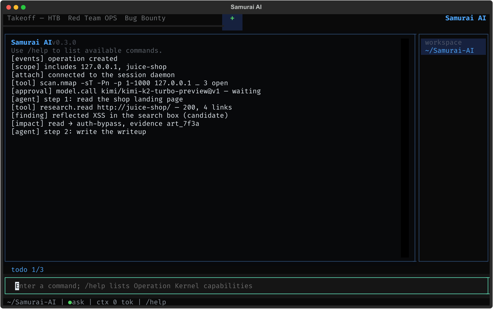

<p align="center">
  
</p>

<p align="center">
  <a href="README.md">Русский</a> · <strong>English</strong>
</p>

# Samurai AI

A local harness for authorized attacking: red teaming, bug bounty, CTF/HTB and operation planning. It runs an operation as a process — boundaries, plan, evidence, report — and keeps the agent inside that process instead of handing a model an unbounded chat with tools.

A terminal interface, all state on the operator's machine, keys in a local vault. Every tool is a container pinned by digest, every out-of-scope call and every dangerous action goes through policy rather than through trust in the model.

<p align="center">
  
</p>

## Install

macOS and Linux, without root and without Python on the machine:

```bash
curl -fsSL https://raw.githubusercontent.com/0nlyr00t/Samurai-AI/main/install.sh | bash
```

The installer takes the signed binary of the latest release, **always** checks its sha256 and, when `cosign` is present, verifies the Sigstore signature bound to the release workflow identity. A mismatch aborts before anything is installed. It installs into `~/.local/bin` and appends that directory to your shell PATH.

- a specific release: `... | bash -s -- --ref v0.3.0`
- no binary for the platform (linux/arm64, for instance): the script falls back to building from source via uv and says so
- `--dry-run` prints the plan and changes nothing

The sandbox needs Docker: tools run in containers, not on the host.

Update with `samurai update` (`--check` only reports a newer version). Verifying release artifacts is covered in `md/compatibility.md`.

## Uninstall

```bash
curl -fsSL https://raw.githubusercontent.com/0nlyr00t/Samurai-AI/main/uninstall.sh | bash
```

It removes the binary, the PATH block, the state directory (`~/.config/samurai`: database, vault key, settings) and the belt images. `--keep-state` keeps the state, `--yes` skips the question (required under `curl | bash`), `--dry-run` shows the plan.

## Capabilities

**The operation is the object.** Four modes (bug bounty, CTF/HTB, red team, operation planning), an audited lifecycle, include/exclude scope for domains, wildcards, URL origins and IP/CIDR, immutable evidence with SHA-256, findings from candidate to reported, snapshots/restore/fork and recovery reconciliation.

**Plan and approvals.** Tasks with dependencies, stages and gates, required artifacts, risks R0–R4. Dangerous execution waits for the operator; `ask`, `yolo`, `never` modes plus per-argument `allow|ask|deny` rules keep policy outside the model.

**Tools.** Reconnaissance (`recon.subfinder-passive`, `recon.dnsx-resolve`, `recon.httpx-probe`), scanning (`scan.nmap`, `scan.nuclei`), fuzzing (`fuzz.ffuf`), browser research with quotes (`research.search`, `research.read`), administration and remote access (ssh, SMB, an RDP probe, ADB), VMs and disks, exploit building and running. A new tool is a JSON manifest signed into the shared allowlist — no new code. Extensions arrive as plugins: a package of tools, profiles and playbooks with a sha256 per file, `plugin check` reports edits, `plugin rm` takes everything back.

**Sandbox.** Docker profiles pinned by digest, `--cap-drop ALL`, read-only root, CPU/memory/PID limits, a scoped egress proxy with DNS pinning and an audit of every connection. The belt is split by blast radius: the admin image carries no compiler, the exploit image carries no foreign credentials.

**Impact and evidence.** A ladder `read → write → auth-bypass → data-export → rce` with scores, a reporting threshold and an escalation budget; reports refuse findings below the threshold (`report generate --min-impact`). Traffic, output and files become artifacts instead of quotes in a chat.

**A live session.** A daemon on a local unix socket: work survives a closed terminal, a second terminal or the TUI screen (`Ctrl-D`) attaches to the stream, answers the agent, approves steps and detaches without losing the work. The socket is 0600, clients are read-only by default, and the shared access table decides.

**A remote daemon over SSH.** `attach --ssh host` reaches a daemon on another machine through a forwarded socket: nothing new crosses the wire and the permissions stay on the far side.

**An air-gapped mode.** `--offline` on an operation refuses remote models and tools that need the internet, with the reason given before the attempt; `offline check` lists what is refused.

**A browser view.** `samurai web <op>` serves a local surface: summary, journal, plan, findings and report downloads. `127.0.0.1` only, a one-off token in the link, nothing is written.

**One command to a run.** `samurai run "<name>" --mode … --include … --task … --model …` creates the operation, chains the plan and works it to the end; `--detach` leaves it with the daemon. `scope host add` describes a vhost with no DNS, `sandbox check` shows which side of a broken path is broken.

**Reports and export.** Markdown/JSON/HTML/PDF reports and an operation dossier built only from validated findings, secret redaction, PDF is printed by pinned headless Chromium and stays a hashed artifact, NDJSON journal export, CALDERA and VECTR campaign export.

**The agent decides and presses.** Inside the plan the agent picks the move: where to go, which tool to take, where to raise the impact with its own `record_impact`. Outside it there are rails: scope, risk classes and approvals, subagents on plan tasks, campaign memory, genes scored by eval, an evaluation harness with regressions, a headless mode for CI. The agent asks the operator mid-step and keeps going when nobody answers.

**Interface.** A TUI with journal, plan, findings and access tabs, an action palette, a run inspector, boards and a key overlay; RU/EN; three themes; rebindable keys. Plus a full CLI for scripts and CI with a stable exit-code contract.

## How it works

1. An **operation** fixes the mode, the goal and the scope.
2. A **plan** breaks the work into tasks with dependencies and gates.
3. The **agent** proposes steps; anything above R0 waits for approval.
4. A **tool** runs in a container; the proxy cuts anything out of scope.
5. A **result** becomes an artifact with a hash and a traffic pair.
6. A **finding** climbs the impact ladder only with evidence.
7. A **report** is assembled from what is confirmed and nothing else.

More detail — implemented specifics, delivery, model policy — lives in [`md/capabilities.md`](md/capabilities.md) (Russian).

## Documentation

- [`md/requirements.md`](md/requirements.md) — requirements.
- [`md/development-plan.md`](md/development-plan.md) — stages, acceptance criteria, status.
- [`md/threat-review-security-tools.md`](md/threat-review-security-tools.md) — per-tool review: what is allowed, what it costs.
- [`md/compatibility.md`](md/compatibility.md) — compatibility and release signature verification.
- [`md/capabilities.md`](md/capabilities.md) — the full capability list and operator commands.
- [`Agent.md`](Agent.md) — development handoff.

## Status

Under active development: 1193 automated tests, green CI gates (ruff, strict mypy, pytest, build), signed releases. Not done: PDF reports, a web surface for an operation, distributed runners, air-gapped models, plugins; ADB and VBoxManage are mock-tested only; genes have no field series yet (`md/night-wave-report.md`).

## Authorized use

Samurai AI is meant for authorized security research, CTF/HTB, bug bounty within program rules and red team/adversary emulation with explicit permission from the system owners. Stay inside the agreed scope.
