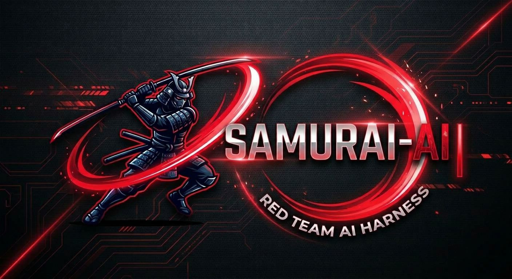
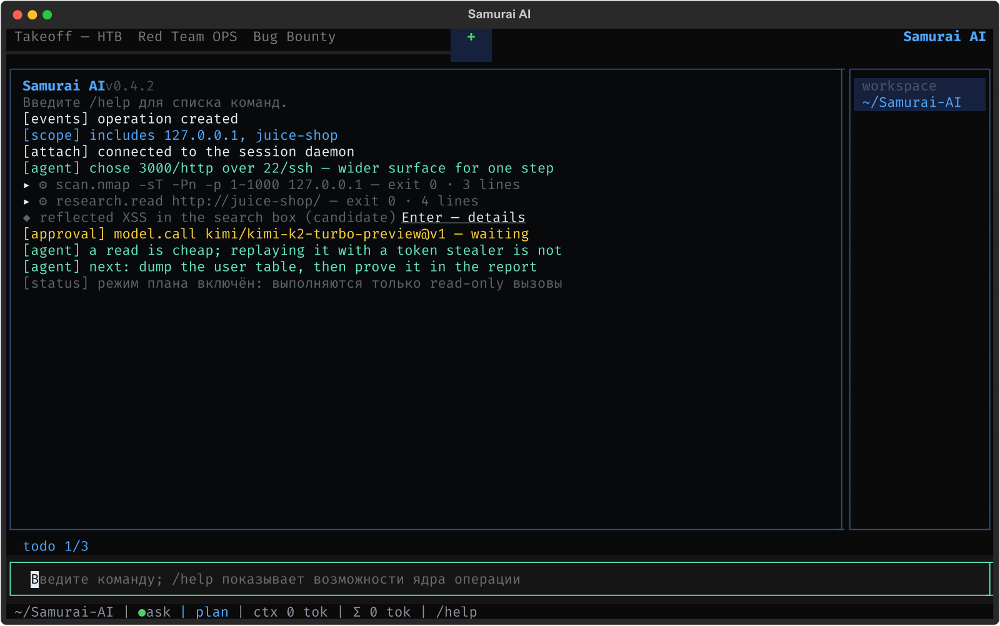

<p align="center">
  
</p>

<p align="center">
  <strong>Русский</strong> · <a href="README.en.md">English</a>
</p>

# Samurai AI

Локальный харнесс для авторизованных атак: Red Team, Bug Bounty, CTF/HTB, планирование операций. Операция ведётся как процесс — границы, план, доказательства, отчёт, — и агент работает внутри этого процесса, а не в свободном чате с инструментами.

TUI и CLI, состояние на машине оператора, секреты в локальном vault. Инструменты исполняются в контейнерах с закреплённым digest; выход за scope и опасные действия проходят через политику, а не через доверие к модели.

<p align="center">
  
</p>

## Установка

macOS и Linux, без root и без Python:

```bash
curl -fsSL https://raw.githubusercontent.com/0nlyr00t/Samurai-AI/main/install.sh | bash
```

Установщик берёт бинарник последнего релиза, сверяет sha256 и, если установлен `cosign`, проверяет Sigstore-подпись с привязкой к identity release-workflow; расхождение — отказ до установки. Ставит в `~/.local/bin` и добавляет каталог в PATH.

- конкретный релиз: `... | bash -s -- --ref v0.4.0`
- `--dry-run` — показать план без изменений
- `--force-uv` — поставить из тега через uv вместо бинарника

Релизы собираются под linux-x86_64, linux-arm64, darwin-arm64 и windows-x86_64. На платформах без артефакта (Intel Mac) установщик собирает из тега через uv. Для песочницы нужен Docker.

Обновление: `samurai update` (`--check` — только проверка версии). Проверка подписей — [`md/compatibility.md`](md/compatibility.md).

## Удаление

```bash
curl -fsSL https://raw.githubusercontent.com/0nlyr00t/Samurai-AI/main/uninstall.sh | bash
```

Сносит бинарник, PATH-блок, состояние (`~/.config/samurai`) и образы белтов. `--keep-state` оставляет состояние, `--yes` не спрашивает, `--dry-run` показывает план; без терминала скрипт ничего не удаляет молча.

## Возможности

**Операция.** Scope расширяется только с подтверждением: `scope add` спрашивает, если правило действительно расширяет границы, и молчит, если цель уже покрыта. Четыре режима (Bug Bounty, CTF/HTB, Red Team, Operation Planning), проверяемый lifecycle, include/exclude scope для домена, wildcard, URL origin и IP/CIDR, неизменяемые доказательства с SHA-256, находки от кандидата до отчёта, снимки, откат, форк, сверка восстановления.

**План и одобрения.** Задачи с зависимостями, стадии и гейты, артефакты-требования, риски R0–R4. Исполнение выше R0 ждёт одобрения оператора; режимы `ask`, `yolo`, `never` и поаргументные правила `allow|ask|deny` держат политику вне модели.

**Инструменты.** `recon.subfinder-passive`, `recon.dnsx-resolve`, `recon.httpx-probe`, `scan.nmap`, `scan.nuclei`, `scan.wpscan`, `fuzz.ffuf`, `research.search`, `research.read`, `intel.shodan`, `intel.censys`, `loot.scan` (креды из тела), удалённое администрирование (ssh, SMB, RDP-проба, ADB), виртуалки и диски, сборка и запуск эксплойтов. Новый инструмент описывается JSON-манифестом; пакеты инструментов, профилей и плейбуков ставятся плагинами с sha256 на каждый файл.

**Песочница.** Docker-профили с закреплённым digest, `--cap-drop ALL`, read-only корень, лимиты CPU, памяти и PID, scoped egress-прокси с DNS pinning и аудитом соединений. Белт разложен по радиусу поражения: админский образ без компилятора, exploit-образ без чужих ключей.

**Импакт.** Лестница `read → write → auth-bypass → data-export → rce` с баллами, порогом отчётности и бюджетом эскалации; отчёт не выпускается по находкам ниже порога. Трафик, вывод и файлы сохраняются артефактами.

**Ход поисков.** Вкладка «Ход» показывает, сколько задач на брутфорс, фазинг и password spray сделано из всего (полоса, процент, счётчик, обновление раз в три минуты) и держит на виду главные находки — по severity, живьём, без глухих дедлайнов.

**Остановка и журнал.** `Ctrl+C` останавливает прогон, а не приложение: текущий шаг доходит до результатов, гипотезы проверяются, вывод печатается — и только потом работа встаёт. Второе нажатие выходит. Серые строки процесса свёрнуты в одну строку и раскрываются `Ctrl+E`, Enter или кликом; при сбое раскрываются сами. Текст выделяется мышью в любой момент: `Ctrl+C` при выделении копирует, двойной клик берёт слово, `Ctrl+Shift+C` копирует всегда.

**Сессия.** Демон на локальном unix-сокете: работа переживает закрытый терминал, второй клиент или экран TUI (`Ctrl-D`) подключается к потоку, отвечает на вопросы агента и одобряет шаги. Сокет 0600, read-only клиенты, права решает общая таблица доступа.

**Удалённый демон.** `attach --ssh host` работает с демоном на другой машине через форвард его сокета; права остаются на удалённой стороне.

**Сеть за релeем.** Если цель видна только из VM или за jump-хостом, `--relay "prlctl exec '<uuid>'"` уводит сетевые инструменты туда; контейнер не нужен, scope и артефакты остаются, адрес самого релeя добавляется в scope. `samurai doctor --relay "<префикс>"` заранее скажет, каких инструментов на той стороне нет.

**Локальные инструменты.** На машине оператора `samurai` берёт уже установленные инструменты нативно, без shell: executable и argv выбирает проверенный рецепт каталога, scope и одобрения остаются обязательными. `samurai tool capabilities` показывает окружение и найденные бинари, ничего не меняя; отсутствующий инструмент ставится по рецепту — `tool provision <id> --dry-run` печатает платформу, пакет, команды, привилегии и healthcheck и ничего не меняет, установка идёт отдельным одобрением (`sudo -n`, без пароля в модели) и без успешного healthcheck инструмент не считается готовым. Повторная установка — no-op, после сбоя нужен новый запуск. Модель называет только `tool_id`: ни имён пакетов, ни install-команд. Релей остаётся запасным транспортом. Подробности — [`md/local-tools.md`](md/local-tools.md).

**Оффлайн-режим.** `--offline` у операции запрещает удалённые модели и инструменты, которым нужен интернет; отказ с причиной приходит до попытки, `offline check` показывает, что отказано.

**Просмотр в браузере.** `samurai web <op>` — сводка, журнал, план, находки, скачивание отчётов. Только `127.0.0.1`, одноразовый токен в ссылке, без записи.

**Без модели.** `samurai discover <цели>` — порты, проба, шаблоны: детерминированный конвейер без ключа и без единого вызова модели, для CI и оффлайна. `samurai doctor` проверяет окружение (docker, права каталога, образы, ключи) и печатает команду установки под ОС.

**Запуск.** `samurai run "<имя>" --mode … --include … --task … --model …` создаёт операцию, план и ведёт его до конца; `--detach` оставляет работу демону. Префлайт проверяет достижимость цели, `--fallback` задаёт вторую модель.

**Отчёты и экспорт.** Markdown, JSON, HTML, PDF и досье операции только из проверенных находок, redaction секретов, NDJSON-экспорт журнала, экспорт кампании в CALDERA и VECTR.

**Автономность.** Шаг внутри плана выбирает агент, включая оценку импакта; снаружи рамки: scope, риск-классы, одобрения, субагенты на задачах, память кампании, genes с фитнесом из eval, evaluation harness, headless-режим для CI.

**Интерфейс.** TUI с лентой из блоков: прогон инструмента — свёрнутый блок со статусом и ошибкой в заголовке, клик или Enter раскрывает; текст выделяется и копируется в любой момент (`Ctrl+C` / `Ctrl+Shift+C`); id задач, находок, артефактов и одобрений кликабельны — сводка в ленте, Enter открывает полный экран деталей; строка состояния показывает часы хода, текущий инструмент и сумму токенов. Вкладки журнала, плана, находок и доступа, палитра действий, доски, оверлей клавиш; RU/EN; три темы; перебиндинг клавиш. CLI с устойчивым контрактом кодов возврата.

## Как это устроено

1. Операция фиксирует режим, цель и scope.
2. План разбивает работу на задачи с зависимостями и гейтами.
3. Агент предлагает шаги; риск выше R0 ждёт одобрения.
4. Инструмент исполняется в контейнере, выход за scope режет прокси.
5. Результат становится артефактом с хешем и парой трафика.
6. Находка поднимается по лестнице импакта только с доказательством.
7. Отчёт собирается из подтверждённого.

Детали реализации и ограничения — [`md/capabilities.md`](md/capabilities.md) и [`md/threat-review-security-tools.md`](md/threat-review-security-tools.md).

## Документация

- [`md/local-tools.md`](md/local-tools.md) — локальные инструменты, установка и её границы.
- [`md/optin-platform-checks.md`](md/optin-platform-checks.md) — ручные проверки на живых платформах.
- [`md/requirements.md`](md/requirements.md) — требования.
- [`md/development-plan.md`](md/development-plan.md) — этапы, acceptance criteria, статус.
- [`md/threat-review-security-tools.md`](md/threat-review-security-tools.md) — разбор инструментов и остаточные риски.
- [`md/compatibility.md`](md/compatibility.md) — совместимость и проверка подписей релизов.
- [`md/capabilities.md`](md/capabilities.md) — полный перечень возможностей и операторские команды.
- [`SECURITY.md`](SECURITY.md) — как сообщать об уязвимостях.
- [`Agent.md`](Agent.md) — handoff для разработки.

## Лицензия

Apache-2.0 — см. [`LICENSE`](LICENSE). Использование, форк и вклад в код допускаются на условиях лицензии; патентный грант включён.

## Состояние

Активная разработка. Не сделано: distributed runners (кроме SSH-туннеля к демону), плагины на Python-хуках.

## Авторизация

Только авторизованный security research: CTF/HTB, Bug Bounty в рамках правил программы, Red Team с явным разрешением владельцев систем. Вне согласованного scope не используйте.
- рельс стадий атаки, блоки доступов/секретов, чек-лист хода модели
